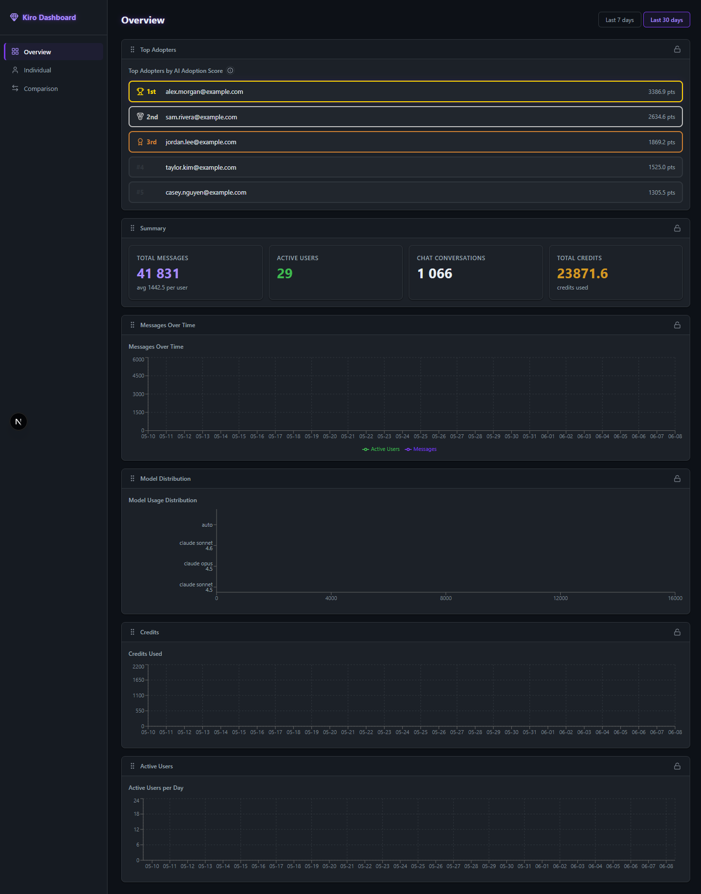
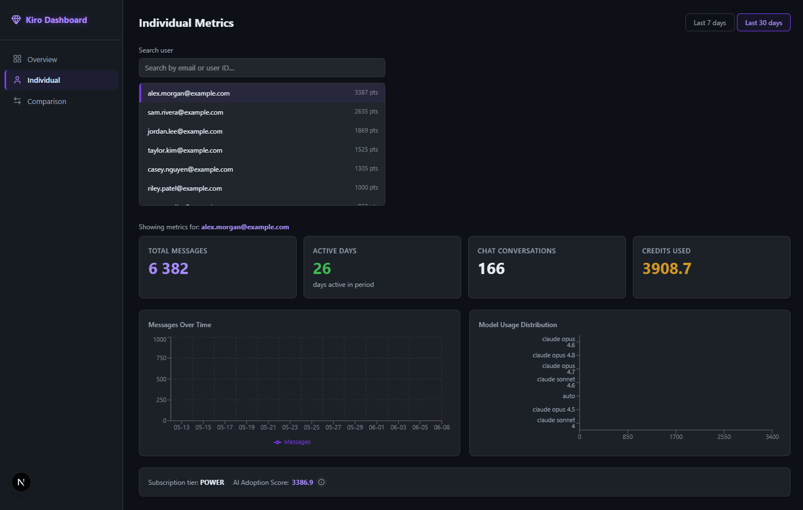
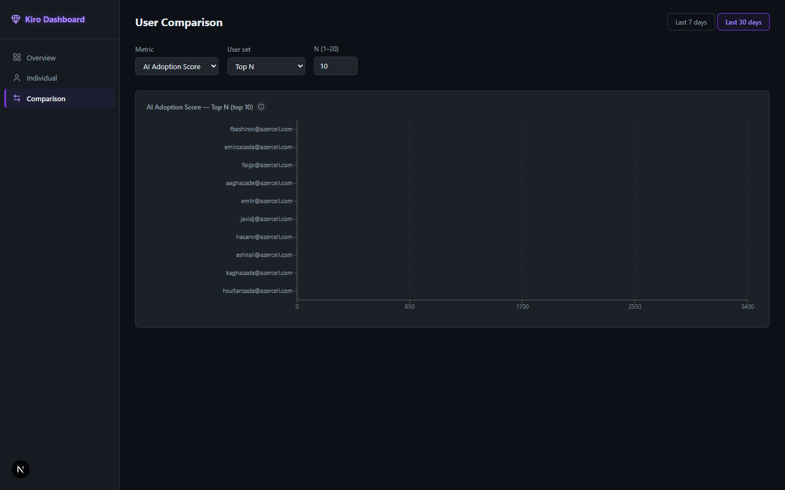
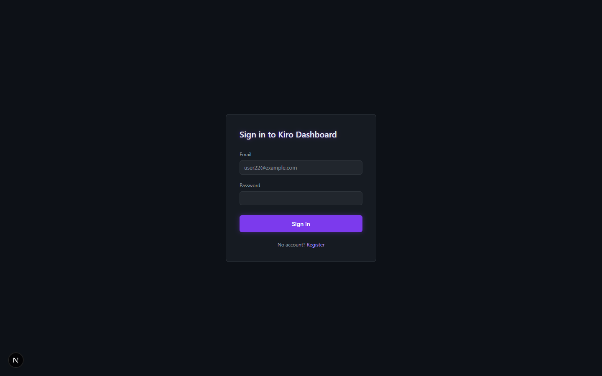

# Kiro NRT Dashboard

> **Built with AI-DLC.** This project was designed and implemented using the
> [AI-Driven Development Life Cycle (AI-DLC)](https://aws.amazon.com/blogs/devops/ai-driven-development-life-cycle/)
> methodology — an AI-led, human-in-the-loop workflow that runs through inception
> (requirements, user stories, design) and construction (per-unit design + code
> generation) before any code is written. The full trail of requirements, plans,
> designs, and decisions lives in [`aidlc-docs/`](aidlc-docs/). See
> [Acknowledgements](#acknowledgements) for links.

A near-real-time metrics dashboard for Kiro IDE/CLI usage, built with FastAPI + Next.js.

## What it does

- Reads daily per-user Kiro activity reports from **S3** (IDE + CLI variants).
- Combines IDE and CLI rows per user; labels users by email (discovered automatically).
- Computes per-user and aggregate metrics, including a **configurable AI Adoption score**
  (weighted sum of Total Messages, Chat Conversations, Credits Used, Active Days).
- Presents a **dark, Kiro-styled dashboard** with:
  - **Overview page** — aggregate charts, Top-5 adopters podium (gold/silver/bronze),
    stat cards; blocks are **drag-to-reorder** and **lockable**.
  - **Individual page** — searchable user selector with per-user charts.
  - **Comparison page** — compare any metric across Top N, Bottom N, Top-5+Bottom-5, or all users.
- Pulls fresh data from S3 **once a day** via a scheduled server-side refresh
  (configurable via the `DAILY_REFRESH_*` variables); data is stored locally between pulls.
- Registration is open; any logged-in user can view all metrics. Auth can be
  bypassed entirely for trusted/internal deploys via `AUTH_DISABLED=true`.

## Screenshots

| Overview | Individual |
|---|---|
|  |  |

| Comparison | Sign in |
|---|---|
|  |  |

---

## Quick Start (Docker Compose)

```bash
# 1. Copy the env template and fill in your real values (AWS creds, S3 bucket/prefix, JWT secret).
cp .env.example .env          # Windows: copy .env.example .env
# Edit .env — see the Configuration table for every variable.

# 2. Build and start both services.
docker compose up --build

# 3. Open the dashboard.
open http://localhost:3000     # Windows: start http://localhost:3000
```

That's it. The backend starts on port **8000**, the frontend on port **3000**.

> **Minimum required to boot:** `AWS_ACCESS_KEY_ID`, `AWS_SECRET_ACCESS_KEY`,
> `S3_BUCKET`, and `S3_BASE_PREFIX` must point at a readable Kiro activity-report
> bucket, and `JWT_SECRET` should be set (unless `AUTH_DISABLED=true`). The
> defaults baked into the app are placeholders and will not return real data.

## Local Development (without Docker)

### Backend

The backend package lives in `backend/`, and `backend/pyproject.toml` defines the
Python project. Install it (plus all runtime + dev dependencies — FastAPI, boto3,
apscheduler, pytest, hypothesis, …) into a local venv:

```bash
# From the repo root — point at the backend project (pyproject.toml is inside backend/):
uv pip install --python backend/.venv/Scripts/python "backend[dev]"

# Provide configuration (or use a .env file at the repo root):
export AWS_ACCESS_KEY_ID=...
export AWS_SECRET_ACCESS_KEY=...
export AWS_DEFAULT_REGION=us-east-1
export S3_BUCKET=your-kiro-activity-bucket
export S3_BASE_PREFIX=AWSLogs/<account-id>/KiroLogs/user_report/us-east-1/
export JWT_SECRET=dev-secret
# Optional: skip login while developing
export AUTH_DISABLED=true

# Run the API FROM THE REPO ROOT so `backend.main` resolves to the live ./backend source:
backend/.venv/Scripts/python -m uvicorn backend.main:app --reload --port 8000
# API available at http://localhost:8000
# Interactive docs at http://localhost:8000/docs
```

> Run uvicorn from the repo root (as shown). Running it from inside `backend/`
> won't resolve the `backend.*` import path.

### Frontend

```bash
cd frontend
npm install
# Point the browser-side client at the backend:
echo "NEXT_PUBLIC_API_URL=http://localhost:8000" > .env.local
npm run dev
# App available at http://localhost:3000
```

### Backend Tests

```bash
# Run from the repo root so the live `backend` package (including backend.tests) resolves:
backend/.venv/Scripts/python -m pytest backend/tests -q
# Unit + integration tests, includes Hypothesis property-based tests (PBT)
```

### Frontend Tests

```bash
cd frontend
npm run test
# vitest + fast-check property-based tests (PBT)
```

## Configuration

All configuration is via environment variables (`.env` file at the repo root, or Docker env).
Copy [`.env.example`](.env.example) to `.env` and fill in real values. Defaults below reflect
[`backend/core/config.py`](backend/core/config.py).

### Data source & credentials

| Variable | Default | Description |
|---|---|---|
| `AWS_ACCESS_KEY_ID` | `""` *(required)* | AWS access key for S3 |
| `AWS_SECRET_ACCESS_KEY` | `""` *(required)* | AWS secret key for S3 |
| `AWS_DEFAULT_REGION` | `us-east-1` | AWS region |
| `S3_BUCKET` | `example-kiro-activity-bucket` *(set to real bucket)* | Bucket holding the Kiro activity reports |
| `S3_BASE_PREFIX` | `AWSLogs/000000000000/KiroLogs/user_report/us-east-1/` *(set to real prefix)* | Key prefix for the daily report CSVs |

### Authentication

| Variable | Default | Description |
|---|---|---|
| `JWT_SECRET` | `change-me-in-production` | ⚠️ Change for production. Generate with `openssl rand -hex 32` |
| `JWT_EXPIRY_MINUTES` | `720` | Token validity (12 h) |
| `AUTH_DISABLED` | `false` | When `true`, bypass login entirely. Trusted/internal use only |

### Daily S3 refresh

| Variable | Default | Description |
|---|---|---|
| `DAILY_REFRESH_ENABLED` | `true` | Enable the scheduled once-a-day S3 pull |
| `DAILY_REFRESH_HOUR` | `7` | Hour of day to pull (CSVs land in S3 ~06:00) |
| `DAILY_REFRESH_MINUTE` | `0` | Minute of the refresh |
| `DAILY_REFRESH_TIMEZONE` | `Asia/Baku` | IANA timezone for the schedule |

### Storage, caching & polling

| Variable | Default | Description |
|---|---|---|
| `DATABASE_PATH` | `data/kiro_dashboard.db` | SQLite file path (Docker overrides to `/app/data/...`) |
| `CACHE_TTL_SECONDS` | `129600` | Metric snapshot cache TTL (36 h — outlives the daily refresh) |
| `EMAIL_MAP_TTL_SECONDS` | `129600` | User email-map cache TTL (36 h) |
| `REFRESH_INTERVAL_SECONDS` | `0` | Frontend polling interval; `0` disables auto-refresh |

### AI Adoption score weights

| Variable | Default | Description |
|---|---|---|
| `ADOPTION_WEIGHT_TOTAL_MESSAGES` | `0.40` | Weight for total messages |
| `ADOPTION_WEIGHT_CHAT_CONVERSATIONS` | `0.30` | Weight for chat conversations |
| `ADOPTION_WEIGHT_CREDITS_USED` | `0.20` | Weight for credits used |
| `ADOPTION_WEIGHT_ACTIVE_DAYS` | `0.10` | Weight for active days |

### Frontend (build-time)

| Variable | Default | Description |
|---|---|---|
| `NEXT_PUBLIC_API_URL` | `http://localhost:8000` | Backend URL the **browser** calls. Inlined at build time, so it must be reachable from the host (not the Docker service name) |

## Architecture

```
browser (port 3000)          Docker Compose          AWS
─────────────────            ──────────────          ───
Next.js 16 SPA          ←─→  FastAPI + SQLite  ←─→  S3 bucket
TanStack Query                uvicorn               (kiro CSVs)
dnd-kit, Recharts             bcrypt + JWT          pulled once/day
lucide-react                  APScheduler           by the scheduler
```

**S3 prefix layout**: `{S3_BASE_PREFIX}{year}/{month}/{day}/00/`

## Project Structure

```
kiro-dashboard/
├── backend/           FastAPI backend (Units 1 & 2)
│   ├── core/          Config, ingestion (S3+CSV parser), metrics engine, scheduler
│   ├── models/        Pydantic models
│   ├── repositories/  SQLite (users + cache)
│   ├── services/      Auth, Metrics, UserDirectory
│   ├── api/           FastAPI routers (auth, metrics, config, health)
│   ├── tests/         Unit + integration tests (Hypothesis PBT)
│   ├── pyproject.toml Backend Python package definition
│   └── Dockerfile
├── frontend/          Next.js 16 frontend (Unit 3)
│   ├── app/           Pages (dashboard, individual, comparison, auth)
│   ├── components/    UI components (charts, podium, drag grid, sidebar)
│   ├── lib/           API client, auth context, TanStack queries, layout
│   ├── styles/        Design tokens (Kiro dark theme)
│   ├── tests/         fast-check PBT
│   └── Dockerfile
├── docs/screenshots/  README screenshots
├── aidlc-docs/        AI-DLC inception & construction artifacts (requirements, design, plans)
├── docker-compose.yml
├── .dockerignore      Backend build-context exclusions (.venv, caches, secrets)
├── .env.example
└── .env               (git-ignored — add your real credentials here)
```

## Acknowledgements

This project was built using the **AI-Driven Development Life Cycle (AI-DLC)**, an
AI-led, human-in-the-loop software development methodology from AWS.

- AI-DLC overview — [AI-Driven Development Life Cycle: Reimagining Software Engineering](https://aws.amazon.com/blogs/devops/ai-driven-development-life-cycle/)
- Open-sourced adaptive workflows — [awslabs/aidlc-workflows](https://github.com/awslabs/aidlc-workflows)
