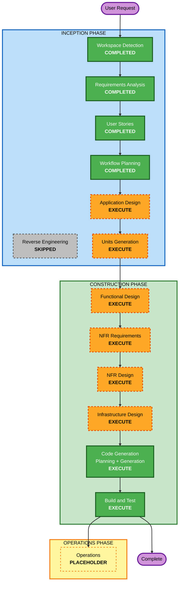

# Execution Plan — Kiro NRT Dashboard

## Detailed Analysis Summary

### Transformation Scope
- **Project Type**: Greenfield (no existing code; brownfield analysis N/A).
- **Primary Changes**: Build a new full-stack application from scratch — FastAPI backend
  (S3 ingestion, metrics engine, auth, REST API) + Next.js/React frontend (dashboard, individual,
  comparison pages) + SQLite app store, packaged with Docker Compose.

### Change Impact Assessment
- **User-facing changes**: Yes — entire product is user-facing (auth, three pages, interactive
  layout, charts).
- **Structural changes**: Yes — new system architecture (backend + frontend + DB + S3 integration).
- **Data model changes**: Yes — app data models (users, saved layouts) and derived metric models
  over an evolving CSV schema.
- **API changes**: Yes — a new REST API contract between frontend and backend.
- **NFR impact**: Yes — NRT auto-refresh + caching, Kiro-like styling, Docker deployment,
  property-based testing (extension enabled), resilient ingestion.

### Risk Assessment
- **Risk Level**: Medium. The scope is broad but self-contained; no production systems are touched.
  The main technical risks are the **evolving S3 CSV schema** and the **interactive layout
  (drag/lock/persist)** — both already de-risked by the live data scan and clear stories.
- **Rollback Complexity**: Easy (greenfield; everything is in version control with frequent commits).
- **Testing Complexity**: Moderate (PBT enforced for parsing and metric logic; UI interaction tests).

## Workflow Visualization



### Text Alternative (always included)

```
INCEPTION PHASE
- Workspace Detection ......... COMPLETED
- Reverse Engineering ......... SKIPPED (greenfield)
- Requirements Analysis ....... COMPLETED
- User Stories ................ COMPLETED
- Workflow Planning ........... COMPLETED (this stage)
- Application Design .......... EXECUTE
- Units Generation ............ EXECUTE

CONSTRUCTION PHASE (per-unit loop, then build & test)
- Functional Design ........... EXECUTE (per unit)
- NFR Requirements ............ EXECUTE (per unit)
- NFR Design .................. EXECUTE (per unit)
- Infrastructure Design ....... EXECUTE (per unit)
- Code Generation ............. EXECUTE (per unit, ALWAYS)
- Build and Test .............. EXECUTE (ALWAYS)

OPERATIONS PHASE
- Operations .................. PLACEHOLDER
```

## Phases to Execute

### 🔵 INCEPTION PHASE
- [x] Workspace Detection (COMPLETED)
- [x] Reverse Engineering (SKIPPED — greenfield, no existing code)
- [x] Requirements Analysis (COMPLETED)
- [x] User Stories (COMPLETED)
- [x] Workflow Planning (IN PROGRESS → completing now)
- [ ] Application Design — **EXECUTE**
  - **Rationale**: A brand-new system needs component identification and a service-layer design
    (ingestion, metrics, auth, API on the backend; pages/components/state on the frontend) plus the
    REST API contract. Multiple new components and their dependencies must be defined.
- [ ] Units Generation — **EXECUTE**
  - **Rationale**: The system decomposes naturally into multiple units of work (e.g., Data &
    Metrics backend, Auth & API backend, Frontend app, Deployment). Structured decomposition keeps
    construction manageable and lets each unit be designed and built coherently.

### 🟢 CONSTRUCTION PHASE (per-unit)
- [ ] Functional Design — **EXECUTE** (per unit)
  - **Rationale**: New data models (users, saved layouts) and non-trivial business logic
    (dynamic CSV parsing, IDE+CLI combination, configurable AI Adoption weighted sum, top/bottom-N
    selection) need detailed design. Also satisfies PBT-01 (property identification).
- [ ] NFR Requirements — **EXECUTE** (per unit)
  - **Rationale**: Performance/NRT targets, caching strategy, and tech-stack confirmation including
    the **PBT framework selection** (Hypothesis, fast-check) per PBT-09 must be captured.
- [ ] NFR Design — **EXECUTE** (per unit)
  - **Rationale**: NRT polling + short-TTL caching patterns, auth/JWT handling, resilient-ingestion
    patterns, and Kiro-styling design tokens need to be incorporated into the design.
- [ ] Infrastructure Design — **EXECUTE** (per unit)
  - **Rationale**: Docker Compose topology (frontend + backend), environment/secret passing, and
    local volume for the SQLite DB must be specified. (Lightweight but needed.)
- [ ] Code Generation — **EXECUTE** (ALWAYS, per unit)
  - **Rationale**: Implementation planning and code generation for every unit.
- [ ] Build and Test — **EXECUTE** (ALWAYS)
  - **Rationale**: Build all units; run example-based + property-based tests; integration checks.

### 🟡 OPERATIONS PHASE
- [ ] Operations — PLACEHOLDER (future deployment/monitoring workflows)

## Estimated Timeline
- **Total stages remaining**: 2 inception (Application Design, Units Generation) + per-unit
  construction (4 design stages + Code Generation across the units) + Build and Test.
- **Estimated Duration**: Iterative — each construction stage gates on your approval.

## Success Criteria
- **Primary Goal**: A working, Kiro-styled NRT dashboard meeting all approved requirements and
  stories.
- **Key Deliverables**: FastAPI backend (S3 ingestion + metrics + auth + REST API), Next.js
  frontend (main/individual/comparison pages with the specified interactions), SQLite persistence,
  Docker Compose setup, and example-based + property-based test suites.
- **Quality Gates**:
  - All Must-priority stories implemented with acceptance criteria satisfied.
  - PBT compliance (extension enabled, full) verified at applicable stages.
  - Build passes and tests (incl. PBT with seed logging) run in CI.
  - Secrets only via `.env`; nothing sensitive committed.
